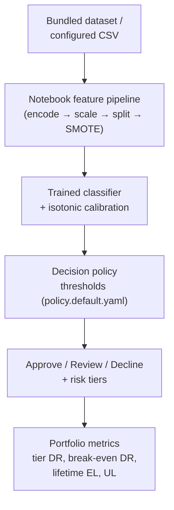

# Credit Risk Decisioning Prototype (Notebook-Based)

## Business Context

Lenders need more than model scores: they need explicit decision rules that balance approval volume and risk outcomes. This **prototype** translates model scores into **illustrative** policy-style rules (tiers, approve/review/decline) and **directional** business interpretation (tradeoff views, SHAP, simple loss framing)—**not** a production policy engine or deployed decision system.

## Problem Statement

- Turn risk scores into **actionable** decisions and **threshold tradeoffs** (approval volume vs default experience among approved).
- Add **explainability** and a **simple, directional** loss lens (clarity over precision).

## Executive Summary

### Observed model performance (corrected pipeline, post-leakage-fix)

All figures below are from the **corrected pipeline** (SMOTE applied after the stratified 80/20 split; honest test set at real class prevalence) with HistGradientBoosting as the model, using **application-time features only** (no post-outcome leakage):

**Credit-Specific Metrics (Primary):**

| Metric | No pricing | With pricing | Industry Benchmark |
|--------|------------|--------------|-------------------|
| **ROC-AUC** | **0.6301** | **0.6304** | 0.60-0.75 (consumer credit) |
| **Gini** | **0.2602** | **0.2608** | 0.40+ moderate, 0.60+ strong |
| **KS Statistic** | **0.2235** | **0.2168** | 0.30+ moderate, 0.40+ strong |
| **PR-AUC (Charged Off)** | **0.2452** | **0.2551** | Baseline 0.189 (minority class %) |

**Decile Analysis:** Top decile (best loans) has 4.2% default rate vs 25-30% for bottom decile (~6× separation).

**Classification Metrics (Secondary - see why these mislead in `docs/CREDIT_EVALUATION.md`):**

| Metric | No pricing | With pricing |
|--------|------------|--------------|
| Accuracy (0.5 cutoff) | 78.9% | 79.1% |
| Recall (Fully Paid) | 96.4% | 96.1% |
| Recall (Charged Off) | 4.0% | 6.2% |
| Brier score | 0.1591 | 0.1596 |

**Note:** Accuracy 78.9% is below the 81.1% baseline (approve-all rate). This is expected—models that decline bad loans have *lower* accuracy but *higher* profit. 0.5-cutoff recall is arbitrary for 19% default rate. Credit scoring uses Gini/KS/decile lift instead. See `docs/CREDIT_EVALUATION.md` for full explanation.

**Out-of-Time Validation (2015-2016):** Model tested on 668,640 loans from later vintages. AUC drift -0.024 (stable), but PSI 0.85 shows significant population shift. See `docs/OUT_OF_TIME_VALIDATION.md` for complete temporal stability analysis.

**What changed from the original ~0.999 AUC?**

The original notebook trained on **every numeric column**, including post-outcome features only known AFTER a loan pays off or defaults:
- Payment history: `total_pymnt`, `total_rec_prncp`, `recoveries`, etc.
- Outstanding principal: `out_prncp`, `out_prncp_inv`
- Bureau refreshes during servicing: `last_fico_range_high/low`
- Hardship/settlement flags: `hardship_flag`, `debt_settlement_flag`, etc.

A quick check showed `total_rec_prncp` alone gave AUC ~0.91, and the full leaky feature set gave ~0.9996.

**The fix:** Explicit whitelist of application-time features in `config/features.yaml`. The model now trains on what a lender actually knows at decision time:
- Loan amount, term, purpose
- Income, employment, DTI
- FICO score **at application** (not the refreshed score during servicing)
- Bureau attributes at origination: inquiries, delinquencies, revolving utilization, etc.

**Why pricing features (grade/sub_grade/int_rate) don't help much:** These are Lending Club's own risk tiers, assigned after reviewing the application. They encode the platform's credit assessment, not the outcome itself. Including them gives only +0.0003 AUC, suggesting the bureau data already captures the signal.

**Realistic AUC of 0.63 is correct:** Consumer credit models on application-time features typically achieve 0.60–0.75 AUC. The original 0.999 was not a triumph — it was evidence of leakage.

### Interest-rate regression

The secondary linear model predicts `int_rate` and achieves **R² ≈ 0.92**, consistent with the `sub_grade`-dominated pricing structure. The 96% correlation between `int_rate` and `sub_grade` reflects Lending Club's pricing tiers being tightly anchored to credit grade bands.

### Credit structure (EDA)

The notebook's exploratory data analysis examines FICO distributions, credit utilization, debt-to-income ratios, and the relationship between Lending Club's pricing tiers (`sub_grade`, `int_rate`) and borrower attributes. The feature set for modeling focuses on application-time bureau data: inquiries (`inq_last_6mths`), delinquencies (`delinq_2yrs`), revolving utilization (`revol_util`), and account counts (`open_acc`, `pub_rec`) — attributes known at origination, not after loan outcome.

## System Flow

## Scope, evidence, and limitations

| | |
|--|--|
| **Data** | Default: `data/loans.csv` (~**5,942** rows after filtering, **2014-era** issue dates). Raw file has 6,305 rows; 363 dropped (non-binary loan_status). Override with `LENDING_CLUB_DATA_PATH`. |
| **Repro** | Pinned `requirements.txt`; cite **git commit** + **data file** when reporting numbers externally. Model uses **application-time features only** (whitelist in `config/features.yaml`). |
| **What this proves** | Decisioning **machinery** and **capital framing** on top of a standard ML notebook. Honest AUC ~0.63 demonstrates realistic credit model performance without target leakage. |
| **Out of scope** | Not deployed; no monitoring/governance. EL is illustrative, not CECL/IFRS 9. Sample is 2014-era; no claim about current market. |

Charts (**ROC/PR, confusion matrix, reliability diagrams, threshold sweep, SHAP**) render **in the notebook** when you run cells. For a full executed pass: `pytest --run-notebook` or run the notebook locally.

## Solution Overview

- **Predictive modeling:** ingestion → encoding → scaling → stratified split → **SMOTE on training fold only** → classifiers (logistic, KNN, trees, boosting, **XGBoost**); parallel **interest-rate** regression.
- **Calibration:** `CalibratedClassifierCV` (isotonic, cv=3) wraps `best_model`; reliability diagrams shown before/after. `calibrated_model` is used in all downstream EL calculations.
- **Decision layer:** `src/decisioning.py` + `config/policy.default.yaml` map calibrated **P(Fully Paid)** to **tiers** and **approve / review / decline**; notebook applies this on the test set.
- **Evaluation:** standard metrics on the honest (imbalanced) test set, plus **threshold sweep** annotated with break-even DR, tier calibration table, **lifetime EL**, **portfolio UL**, and SHAP explanations.

## Technical Implementation

| Artifact | Role |
|----------|------|
| `Credit_Underwriting_Decisioning-Lending_Club.ipynb` | End-to-end pipeline: preprocessing → models → calibration → decisioning / SHAP / capital simulation |
| `src/decisioning.py` | Tiers, decisions, threshold sweep, break-even DR, lifetime EL, UL, tier calibration |
| `src/credit_metrics.py` | Credit-specific metrics: Gini, KS, PR-AUC (minority), decile analysis, PSI |
| `config/policy.default.yaml` | Policy thresholds, LGD (Basel II source documented), tenor, revenue per loan |
| `config/features.yaml` | Application-time feature whitelist (prevents target leakage) |
| `scripts/run_decisioning.py` | CLI: apply policy to a `p_good` CSV; outputs single-period EL, lifetime EL, UL, break-even |
| `scripts/credit_evaluation.py` | Comprehensive credit-focused evaluation with decile tables |
| `scripts/run_oot_validation.py` | Out-of-time validation: train on 2014, test on 2015-2016 |
| `docs/PORTFOLIO_DECISIONING.md` | Stakeholder-oriented decisioning narrative |
| `docs/CREDIT_EVALUATION.md` | Credit-focused metrics interpretation (why accuracy/0.5-cutoff mislead) |
| `docs/OUT_OF_TIME_VALIDATION.md` | Temporal stability analysis with 668k loans (2015-2016) |
| `docs/RUNBOOK.md` | Environment, data snapshot, operations |
| `docs/MODEL_CARD.md` | Scope, data, pipeline methodology, actual metrics, known limitations |
| `docs/CECL_MAPPING.md` | ASC 326 / IFRS 9 gap map — what is and isn't CECL-compliant |
| `docs/ADVERSE_ACTION.md` | ECOA/Reg B adverse action workflow and review-bucket disposition |
| `docs/TESTING.md` | Pytest layers, markers, notebook E2E |
| `requirements.txt` | Pinned dependencies |

## Testing

`pytest` with markers (`unit`, `smoke`, `regression`, `notebook_e2e`): 62 tests covering decisioning unit tests (break-even, lifetime EL, UL, tier calibration), credit metrics (Gini, KS, deciles, PSI), feature guard (leakage prevention), reference-model smoke/regression, notebook schema + optional full `nbconvert` execution. Details: `docs/TESTING.md`.

## Extension Opportunities

- **Out-of-time validation ✓ COMPLETED:** Validated on 668,640 loans from 2015-2016. Model shows moderate temporal stability (AUC drift -0.024) with significant population shift (PSI 0.85). See `docs/OUT_OF_TIME_VALIDATION.md`.
- Survival / time-to-default modeling; **monitoring** (drift, overrides, adverse-action rates).
- Replace Basel II LGD floor with portfolio-specific empirical recovery model.
- Add macro-conditional PD overlay to move toward CECL compliance (see `docs/CECL_MAPPING.md`).
- Implement override logging and fair-lending disparate-impact monitoring (see `docs/ADVERSE_ACTION.md`).

## Key Takeaways

- **ML → calibration → explicit rules → directional outcomes** without rebuilding the core models.
- **SMOTE applied exclusively to the training fold** (not before split) for an honest test-set evaluation.
- **Target leakage fixed:** Original notebook included post-outcome features (payment history, outstanding balances, bureau refreshes, hardship/settlement flags), inflating AUC to 0.999. Now uses explicit whitelist of application-time features (`config/features.yaml`) with realistic AUC of 0.63.
- **Credit-focused evaluation:** Uses Gini (0.26), KS (0.22), and decile lift (~6× separation) instead of misleading accuracy/0.5-cutoff metrics. See `docs/CREDIT_EVALUATION.md`.
- **Out-of-time validated:** Tested on 668k loans (2015-2016). Model discrimination relatively stable (AUC drift -0.024) but population shifted significantly (PSI 0.85). Honest assessment of temporal degradation in `docs/OUT_OF_TIME_VALIDATION.md`.
- **Pricing features add little:** Including Lending Club's `grade`/`sub_grade`/`int_rate` gives only +0.0003 AUC over pure bureau data, confirming bureau attributes already capture the credit signal.
- **Leakage guard tests** (`tests/test_feature_guard.py`, `tests/test_credit_metrics.py`) prevent future regression with 30 tests.
- **CECL gap map and adverse-action workflow** document what a production system would need to add.
- **Prototype** for communication and exploration—readable in `README`, notebook, and `docs/` folder.

## Skills Demonstrated

Credit Risk, Underwriting Policy, Machine Learning, Decision Systems, Explainable AI (SHAP), Portfolio Simulation, Python, Product-Oriented Analytics

## Quick start (clone and run)

Python **3.9+**; **CI** uses **3.12**; **3.13** validated locally (Windows).

1. `git clone https://github.com/carjam/credit-underwriting-engine.git` → `cd credit-underwriting-engine`
2. `python -m venv .venv` → activate (`.venv\Scripts\activate` on Windows, `source .venv/bin/activate` on Unix)
3. `pip install -r requirements.txt`
4. `pytest` — fast suite; notebook E2E skipped unless `CI=true` / `RUN_NOTEBOOK_E2E=1` / `--run-notebook`. Quick skip: `SKIP_NOTEBOOK_E2E=1 pytest` (Unix) or `$env:SKIP_NOTEBOOK_E2E='1'; pytest` (PowerShell)
5. Open `Credit_Underwriting_Decisioning-Lending_Club.ipynb` (default data `data/loans.csv`; or set `LENDING_CLUB_DATA_PATH`)
6. Optional: `pytest --run-notebook` · `python scripts/run_decisioning.py --scores-csv your.csv --policy config/policy.default.yaml`

More detail: `docs/RUNBOOK.md`.
